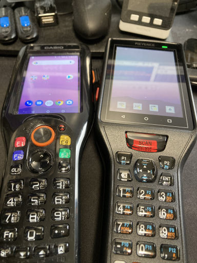
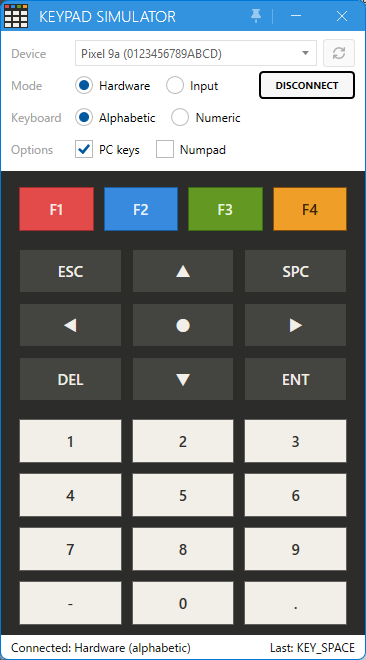

# Template project for MAUI with physical keys

[English](README.md) | 日本語

物理キー付きの端末向けの、物理キー(数字・矢印・Enter・Esc・F1～F4 など)だけで操作する Android アプリの MAUI のテンプレートプロジェクト。



## ✨ 主な機能

- 数字キー・F キーでのボタンのショートカット
- 上下左右キーによる完全なフォーカスの移動
- ハードキーボード向けの入力欄
- 入力の検証時のフォーカス制御
- キーで操作するリスト
- キーだけで操作するダイアログ

## 🧩 クラス

| クラス | 場所 | 役割 |
|---|---|---|
| `KeyInputDriver` / `KeyMap` | Platforms/Android | 物理キーイベントを論理キーイベントとして InputManager へ渡す入力部分 |
| `InputManager` | Input | 画面とポップアップの管理とイベントの配信 |
| `InputBehavior` | Input | MainPage とポップアップのキーの制御 |
| `Shortcut.Key` | Input | ショートカット用のマーカー |
| `ShortcutBehavior` | Input | ショートカットによるコマンド実行 |
| `CollectionViewShortcutBehavior` | Input | CollectionView の物理キーによる制御 |
| `ControlKeyHandling` | Input | Slider・Stepper の左右、日付・時刻のダイアログの Esc 等の制御 |
| `KeyFocus` | Input | 物理キーによるフォーカス制御のマーカー |
| `Focus` | Behaviors | フォーカス制御用のマーカー |
| `EntryController` + `EntryBind` | Messaging / Behaviors | VM から入力欄の文字・有効・フォーカスを扱うメッセンジャーと Behavior |
| `EntryOption` | Behaviors | ハードキーボードがある間はソフトキーボードを出さない・全選択・Enter・入力の制限等の指定 |
| `HardKeyboard` | Platforms/Android | ハードキーボード(キーパッドを含む)の検知 |
| `ElementHelper` | Helpers | フォーカスの移動 |
| `NavigationFocusPlugin` | Extender | 画面の既定のフォーカスと、戻った時のフォーカス制御 |
| `PopupFocusPlugin` / `PopupInputPlugin` | Extender | ポップアップの既定のフォーカスと閉じた後の制御 |
| `IDialog`(MauiComponents) | MauiProgram | 物理キー対応のダイアログ設定(Esc でのキャンセル等) |
| `ValidateInputsAsync` | Modules(AppViewModelBase) | 入力欄の検証と、エラーの後のフォーカス |

## ⌨️ キーの流れ

```
MainActivity.DispatchKeyEvent / キーイベントのフック
  └─ KeyInputDriver ……… 物理キーイベントの論理キーイベントへの変換
       └─ InputManager ……… 最上位のハンドラー(画面・ポップアップ)へのイベントの配信
            └─ InputBehavior
                 ├─ 1. 処理中のイベント実行判定
                 ├─ 2. ショートカット処理実行
                 ├─ 3. 上下左右 → フォーカスの移動(XAML 順)
                 ├─ 4. Shortcut.Key の判定 → タッチと同じ操作
                 └─ 5. Esc → 戻る、ポップアップのキャンセル
```

## 🛠️ 使い方

### 数字キー・F キー

`Shortcut.Key` を付けた要素は、そのキーでタッチと同じ動作を行う。  
Button はタップ、CheckBox・Switch は切り替え、RadioButton は選択、他の要素はフォーカス。

```xml
<Button Style="{StaticResource MenuButton}"
        Command="{Binding ForwardCommand}"
        CommandParameter="{markup:ViewId KeyEntry}"
        input:Shortcut.Key="Num1"
        Text="1.Entry" />
```

### フォーカスの移動

上下左右で XAML に書いた順に前後へ移動。  
範囲は画面の中だけで、既定の動作では端で止まる仕様。

| 添付プロパティ | 付ける所 | 動き |
|---|---|---|
| `Focus.Default` | 要素 | 画面を開いた時にフォーカスを設定(無ければ最初の要素) |
| `Focus.SuppressDefaultFocus` | 画面・ポップアップ | 既定のフォーカスを置かない指定 |
| `KeyFocus.Skip` | 要素 | 上下左右の移動でスキップする指定 |
| `KeyFocus.Wrap` | 画面・ポップアップ | 端から反対の端へ折り返す指定 |
| `KeyFocus.Scope` | コンテナ | 移動する範囲 |

```xml
<ContentView ...
             input:KeyFocus.Wrap="True">
```

### 一覧

上下で行を選択し、先頭・最後の行では一覧の外へ移動。  
`KeyCode` のキーで選んだ行を `Command` に渡す。  
`SelectByNumberKey` は 1～9 キーで 1～9 行目を選択する。

```xml
<CollectionView ItemsSource="{Binding Items}"
                SelectionMode="Single">
    <CollectionView.Behaviors>
        <input:CollectionViewShortcutBehavior Command="{Binding SelectCommand}"
                                              KeyCode="Enter"
                                              SelectByNumberKey="True" />
    </CollectionView.Behaviors>
</CollectionView>
```

### 入力欄

Enter で `EntryController` のコマンドを実行、`Handled` の結果により次の欄へ移動。  
ハードキーボードがある間は、入力欄にフォーカスがあってもソフトキーボードを表示しない(`InputEntry` のスタイル)。  
表示するときは `ShowSoftInputAsync()` を呼ぶ。

```xml
<Entry Style="{StaticResource InputEntry}"
       behaviors:EntryBind.Controller="{Binding Input1}" />
```

```csharp
Input1 = new EntryController(MakeDelegateCommand<EntryCompleteEvent>(Input1Complete));

private void Input1Complete(EntryCompleteEvent ice)
{
    ice.Handled = String.IsNullOrEmpty(Input1.Text);
}
```

### 入力の検証

`EntryController` のプロパティに DataAnnotations の属性を付けて、`ValidateInputsAsync` で名前の順に検証する。  
エラーは VM の `Errors` に入る。  
VM には `[GenerateAccessor]` が必要。

```csharp
[GenerateAccessor]
public sealed partial class KeyEntryViewModel : AppViewModelBase
{
    [Required(ErrorMessage = "Input1 is required")]
    public EntryController Input1 { get; }

    [Required(ErrorMessage = "Input3 must be 3 digits")]
    [RegularExpression("^[0-9]{3}$", ErrorMessage = "Input3 must be 3 digits")]
    public EntryController Input3 { get; }

    protected override async Task OnNotifyFunction2()
    {
        if (await ValidateInputsAsync(dialog, nameof(Input1), nameof(Input3)))
        {
            await dialog.InformationAsync("OK");
        }
    }
}
```

### ダイアログとポップアップ

- `IDialog`(MauiComponents): 既定のボタンにフォーカスされ、Esc でキャンセルする設定。閉じた後は開く前の要素にフォーカスが戻る
- ポップアップ: 既定のフォーカスは `Focus.Default` の要素におかれる。Esc でキャンセルして閉じる
- 処理中の間はキーイベントを捨てる

### コントロール

MauiProgram の `ConfigureControlKeyHandling()` で次のような設定をしている。

- Slider: 左右で 5% ずつ移動。端では隣のコントロールへ移動
- Stepper: 左右で増減。端では隣のコントロールへ移動
- DatePicker・TimePicker: Enter でダイアログを開き、Esc でキャンセルする

## 📱 サンプルの画面

| 画面 | KeyMenu | 内容 |
|---|---|---|
| Entry | 1 | 入力欄 3 つと複数行の入力欄、Enter でアクション、F2 で検証、F3 で Input1 の有効・無効、F4 で Input3 に値 |
| List | 2 | リスト(上下・数字キー・Enter) |
| Dialog | 3 | ダイアログ・数値のポップアップ・Indicator・Loading |
| Control | 4 | CheckBox・Switch・RadioButton |
| Mixed | 5 | 各種コントロールを 1 画面に置いた時の確認用 |

## 🔍 確認方法

物理キーボードがない場合は、PC からキーパッドの模擬ツールか adb でキーを送信して確認する。

### キーパッドの模擬ツール

`tools/Template.Tools.KeypadSimulator` の WPF のツール。  
USB デバッグでつないだ端末へキーパッドのキーを adb で送る。



- Mode の Hardware では仮想の USB キーボードとして送る(端末からは物理キーボードに見える)。Input は `input keyevent` で送る
- Connect で開始し、Disconnect かツールを閉じると仮想のキーボードが消える
- `appsettings.json` で設定変更可能

### adb

adb の keyevent では、ソフトキーボードが出て数字を組み立てることがある。

```
adb shell input keyevent KEYCODE_1
adb shell input keyevent KEYCODE_DPAD_DOWN
adb shell input keyevent KEYCODE_F1
adb shell input keyevent KEYCODE_ESCAPE
```

## ⚠️ Focus() でソフトキーボードが出る問題と対応

### MAUI の実装

- MAUI の Android の実装では、ソフトキーボードを明示的に出す `InputMethodManager.ShowSoftInput(view, 0)` の呼び出し箇所がある
- フォーカス済みの Entry・Editor で `Focus()` を呼ぶと、`ShowSoftInputOnFocus` を見ずにこれが呼びだされる
- `InputView.MapFocus` → `InputViewExtensions.ShowKeyboardIfFocused` → `ViewExtensions.ShowSoftInput`の経路
- override では対応が難しい
  - 3 つとも MAUI の internal static のメソッドで、override できない箇所の処理
  - `EntryHandler` を派生させても、Focus は静的な `EntryHandler.CommandMapper` を通るため、避けるにはハンドラーごと差し替えて Focus を作り直すことになる
  - Android の `EditText` の側にも、`InputMethodManager` の呼び出しを止める仮想メソッドが無い

### 問題

- `EntryOption.DisableShowSoftInputOnFocus` で `ShowSoftInputOnFocus` を false にしても、この呼び出しを抑制できない
- そのため、Focus のコマンドを外側から包んで、元の処理を通さない対応が必要になる

### 対応方法

- `EntryOption` で、`EntryHandler`・`EditorHandler` の Focus のコマンドを `CommandMapper.ModifyMapping` でラップする
  - フォーカス済み かつ `ShowSoftInputOnFocus` が false の時は、MAUI の処理を通さずに結果だけ返すようにする。フォーカスは既にあるので状態は変わらない
- ラップするのは `UseMauiApp` より後(`ConfigureCustomBehaviors`)で、MAUI が設定した `InputView.MapFocus` を外側からラップするため
- Prompt のダイアログ(`IDialog` の `SuppressPromptSoftInput`)は、ハードキーボードがある間はウィンドウを `SoftInput.StateHidden` にし、入力欄を `ShowSoftInputOnFocus = false` にする
- ハードキーボードの有無は `HardKeyboard`で検知する。英字のキーボード(`qwerty`)と、数字キー(0～9)を持つキーボードの機器を「有り」と判定する。音量ボタンなどの数字キーの無い機器は数えない
- ソフトキーボードを明示的に表示する時は `ShowSoftInputAsync()` を呼ぶ

```csharp
// Behaviors/EntryOption.android.cs(Editor も同じ)
EntryHandler.CommandMapper.ModifyMapping(nameof(IEntry.Focus), static (handler, view, args, next) =>
{
    if (!SuppressFocusSoftInput(handler.PlatformView, view, args))
    {
        next?.Invoke(handler, view, args);
    }
});

private static bool SuppressFocusSoftInput(TextView editText, IView view, object? args)
{
    if ((args is not FocusRequest request) || !view.IsFocused || editText.ShowSoftInputOnFocus)
    {
        return false;
    }

    request.TrySetResult(true);
    return true;
}
```

### 注意

- Material3(`UseMaterial3`)では、Entry・Editor のハンドラーが MAUI の内部のクラス(`EntryHandler2`・`EditorHandler2`)に替わり、Focus のコマンドのラップも `EntryOption` のマッパーも効かない
  - 本テンプレートでは `UseMaterial3` はオフ
- SearchBar は対象外(AndroidX の SearchView が自分でソフトキーボードを出す)
- 英字の無いキーパッドでテキストの入力欄に数字を打つと、IME がソフトキーボードを出し、組み立て中は F キーが効かない
  - 数字だけを使用する入力欄は `Keyboard="Numeric"` にする
- MAUI のバージョンアップ時は、`InputView.MapFocus`・`InputViewExtensions.ShowKeyboardIfFocused`・`TextViewExtensions.Focus` の実装が変わっていないかを確認する

## 📦 template-maui に物理キー対応を追加する時

template-maui に物理キーの操作を追加する時に使用するファイルについて。  
「コピー」のファイルはそのまま追加し、「置き換え」のファイルはこのテンプレートのファイルで置き換えます。  
「マージ」のファイルには template-maui の機能も入っているので、上書きせずに表の部分だけをマージします。

### コピー

| ファイル | 補足 |
|---|---|
| `Input/` | すべて |
| `Platforms/Android/KeyInputDriver.cs` / `KeyMap.cs` / `HardKeyboard.cs` | |
| `Extender/PopupInputPlugin.cs` | |

### 置き換え

| ファイル | template-maui との違い |
|---|---|
| `Helpers/ElementHelper.cs` / `ElementHelper.android.cs` | XAML に書いた順のフォーカスの移動と、入力欄以外へのフォーカスの制御 |
| `Extender/NavigationFocusPlugin.cs` / `PopupFocusPlugin.cs` | 戻した画面のフォーカス制御、ポップアップを閉じた後のフォーカスを戻す制御 |
| `Behaviors/EntryBind.cs` | Enter の制御 |
| `Behaviors/EntryOption.android.cs` | ハードキーボードがある間の制御 |

### マージ

| ファイル | 足すもの |
|---|---|
| `Extensions.cs` | `SetDefaultFocus` を追加 |
| `Platforms/Android/MainActivity.cs` | `KeyInputDriver` のフィールドと `DispatchKeyEvent` のオーバーライド、ハードキーボードがある間のウィンドウの `StateHidden`(`OnResume`・`OnPause`) の追加 |
| `MainPage.xaml` | ページの Behaviors の `InputBehavior`、コンテンツ領域の `KeyFocus.Scope`、F キーのボタンの `Shortcut.Key`(Function1～Function4) を追加 |
| `MauiProgram.cs` | `HandleEnterKey`・`DisableShowSoftInputOnFocus` を true、`ConfigureControlKeyHandling()`、ダイアログの `DismissKeys`・`IgnorePromptDismissKeys`・`EnableDialogButtonFocus`・`SuppressPromptSoftInput`、`AddComponentsPopupPlugin<PopupInputPlugin>()` |

## 🔗 リンク

[template-maui](https://github.com/usausa/template-maui)
